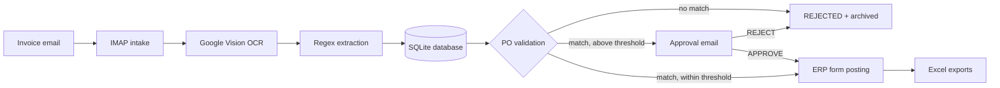

# Invoice Automation — Junior Automation Developer Technical Test


End-to-end Python automation for processing vendor invoices:

```
invoice email -> OCR (Google Vision) -> regex extraction -> database (SQLite)
-> PO validation -> email approval (when above threshold)
-> ERP posting via browser (Selenium) -> Excel exports -> file archiving
```

Built for production-style operation: modular (one module per step),
configuration-driven (no hardcoded paths, thresholds, URLs, or
credentials), safe to run unattended (per-invoice error isolation,
process logging, idempotent re-runs), and portable across Windows
machines — it is run by the reviewer on their own laptop with their
own mailbox, API key, and unseen invoices.

## Quick start — step by step

Prerequisites: **Python 3.10+** and **Google Chrome**.

1. **Get the code** — clone this repository and open a terminal in the
   project folder.
2. **Create a virtual environment** (recommended):

   ```bash
   python -m venv env
   env\Scripts\activate        # Windows (PowerShell/CMD)
   ```

3. **Install dependencies**:

   ```bash
   pip install -r requirements.txt
   ```

4. **Configure secrets** — copy `.env.example` to `.env` and fill in
   the Vision API key and your mailbox credentials (for Gmail use an
   App Password). Details in *Setup → 1* below.
5. **Create the ERP form and fill in `Config.xlsx`** — a Google Form
   or Microsoft Form with the 8 short-answer questions listed in
   *Setup → 2*; then paste its URL into `FormsUrl`, set
   `ApproverEmail`, and check `ThresholdAmount`.
6. **Run it**:

   ```bash
   python main.py --wait-approval 10
   ```

   This fetches new invoice emails, processes them, and waits up to
   10 minutes for approval replies, so approved invoices get posted in
   the same run. Other modes are listed under *Running*.
7. **Feed it an invoice** — email an invoice image to the configured
   mailbox. A matching invoice above the threshold triggers an
   approval email; reply `APPROVE` (subject unchanged) and the invoice
   is posted to the form automatically.
8. **Check the results** — `output/Invoices.xlsx` (all invoices),
   `output/ERP_Dummy.xlsx` (posted only), `output/ProcessLogs.xlsx`
   (audit trail), the archived images under
   `output/Processed/<result>/`, and the form's responses — the same
   `PostingRef` appears in all of them.

## Project structure

| File | Responsibility |
|---|---|
| `main.py` | Orchestrates the pipeline; CLI entry point |
| `config_loader.py` | Reads `Config.xlsx` (business config) and `.env` (secrets) |
| `email_intake.py` | IMAP: downloads image attachments from unread emails |
| `mail_client.py` | Shared IMAP/SMTP connection helpers |
| `vision_ocr.py` | Google Cloud Vision OCR (API key via REST, or service account via SDK) |
| `extractor.py` | Regex extraction of InvoiceNumber, VendorName, PO_Number, Amount, Currency |
| `po_validation.py` | Validates an invoice against `PurchaseOrders.csv` |
| `database.py` | SQLite storage: `invoices` + `process_logs` tables |
| `approval.py` | Sends approval requests (SMTP) and reads APPROVE/REJECT replies (IMAP) |
| `erp_posting.py` | Selenium: fills and submits the ERP simulation form |
| `exporters.py` | Exports `Invoices.xlsx`, `ERP_Dummy.xlsx`, `ProcessLogs.xlsx` from the database |
| `samples/` | The 3 sample invoice images from the test pack |

## Setup in detail

Requirements: Python 3.10+, Google Chrome (for the ERP form posting).

```bash
pip install -r requirements.txt
cp .env.example .env   # then fill in the values (Windows: copy .env.example .env)
```

### 1. Fill in `.env` (secrets — never committed)

- `GOOGLE_VISION_API_KEY` — the Vision API key provided for this test.
- `IMAP_*` / `SMTP_*` — your own mailbox. For Gmail, enable IMAP and use
  an **App Password** (Google Account → Security → App passwords), not
  your normal login password.
- `HEADLESS=false` — the browser stays visible, as required by the
  brief; set `true` only for unattended/orchestrated runs.

### 2. Create the ERP form and update `Config.xlsx`

Create a Microsoft Form or Google Form with these **short-answer
questions** (the automation finds fields by these label keywords, so
keep the words in the question titles):

1. `InvoiceNumber`
2. `VendorName`
3. `PO_Number`
4. `Amount`
5. `Currency`
6. `PostingDate`
7. `ApprovalStatus`
8. `PostingRef`

Then in `Config.xlsx`:

- `FormsUrl` — paste your form's URL (replaces the placeholder).
- `ApproverEmail` — the approver's real email (replaces the example).
- `ThresholdAmount` — approval threshold (default 1000000 IDR). It is
  read from this file at every run — never hardcoded.
- `ExcelERPPath` — informational path label for the ERP export.

### 3. Reference data

`PurchaseOrders.csv` is the PO master data used for validation
(PO number, vendor, total amount, currency, active flag).

## Running

```bash
# A. Email mode (default): fetch new invoice emails, process everything
python main.py

# B. Folder mode: process every image in a folder (handy for testing)
python main.py --source folder --folder samples

# C. One run that also waits up to 10 minutes for approval replies
python main.py --wait-approval 10

# D. Demo: core flow with the samples' verified OCR text, no credentials
python main.py --demo

# E. Watch mode: keep running, repeat the email cycle every 3 minutes
python main.py --watch 3
```

For unattended operation, either run watch mode (`--watch N`) or
schedule `python main.py` (e.g. Windows Task Scheduler every
15 minutes). Approval replies are picked up at the start of the next
cycle: approved invoices are then posted, rejected ones are closed —
an invoice is **never** posted before approval when its amount is
above the threshold.

Exit codes: `0` = run completed (per-invoice failures are recorded in
`ProcessLogs.xlsx`, they do not stop the run), `2` = configuration or
credential problem that must be fixed first.

## How an invoice flows



Sample exports produced by the demo run are in [`examples/`](examples/).

1. **Intake** — attachment saved to `inbox/`; the email is marked read
   only after its attachments are safely stored.
2. **OCR + extraction** — Vision reads the image; regex extracts the 5
   fields (tolerant to `Rp`, thousand separators `.` or `,`, letter
   case). Missing fields are logged, never guessed.
3. **Validation** — against `PurchaseOrders.csv`:
   `MATCH`, `PO_NOT_FOUND`, `PO_INACTIVE` (PO exists but is flagged
   inactive), `VENDOR_MISMATCH`, `AMOUNT_MISMATCH`,
   `CURRENCY_MISMATCH`, or `INCOMPLETE`. Non-matching invoices are
   rejected and archived.
4. **Approval** — matching invoices with `Amount > ThresholdAmount`
   trigger an approval email containing a CorrelationId. The approver
   replies `APPROVE` or `REJECT` (subject unchanged).
5. **ERP posting** — Selenium opens the form (visible browser), fills
   the invoice data plus its **PostingRef** (`POST-<InvoiceNumber>`,
   generated once and stored in the database — the same value appears
   in the form responses, `ERP_Dummy.xlsx`, and `Invoices.xlsx`).
6. **Export + archive** — the three Excel files are re-exported from
   the database, and each image is moved to
   `output/Processed/<result>` where result is `POSTED`, `REJECTED`,
   `AWAITING_APPROVAL`, `POST_FAILED`, or `FAILED`.

Every step and error is written to the `process_logs` table (exported
to `ProcessLogs.xlsx`) with the invoice's CorrelationId, so any single
invoice can be traced end to end.

## Verified behavior (sample invoices)

| Sample | Result |
|---|---|
| INV-2025-001 — PT Maju Jaya, PO-001, IDR 1,200,000 | MATCH, above threshold → approval requested |
| INV-2025-002 — PT Sukses Makmur, PO-002, IDR 2,500,000 | MATCH, above threshold → approval requested |
| INV-2025-003 — PT Tidak Ada, PO-999, IDR 950,000 | PO_NOT_FOUND → rejected (below threshold, but PO does not exist) |

## Troubleshooting

- **"kredensial Vision kosong"** — `GOOGLE_VISION_API_KEY` missing in `.env`.
- **IMAP login fails on Gmail** — use an App Password and enable IMAP
  in Gmail settings.
- **"FormsUrl ... masih placeholder"** — create the form (step 2) and
  paste its URL into `Config.xlsx`.
- **A form field is left empty** — its question title does not contain
  any keyword the automation looks for; rename the question to include
  the field name (e.g. "PO Number (PO_Number)").
- **Test email sending safely** — set `MAIL_DRY_RUN=true` in `.env`;
  emails are printed instead of sent.

## Notes for the reviewer

- AI tools were used while building this project, as allowed by the
  brief; the code is structured so every module can be explained and
  modified independently.
- The database (`invoices.db`, SQLite) is the single source of truth;
  all Excel files are exports regenerated at the end of every run.
